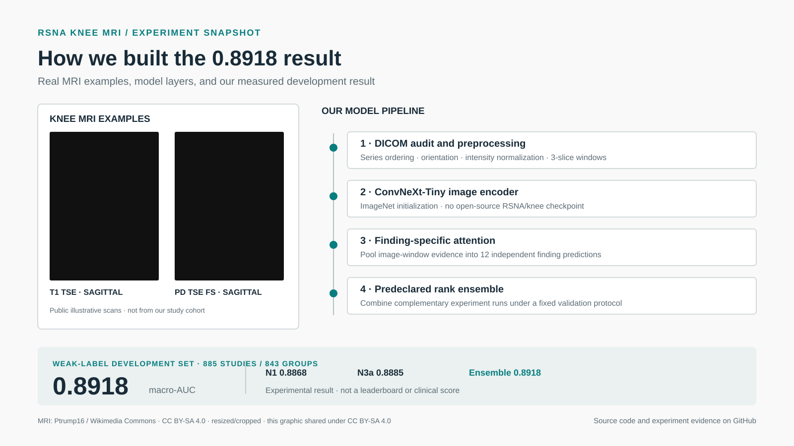

# LinkedIn publication: RSNA knee MRI study

## Title

**From MRI slices to 12 findings: an experiment driven RSNA knee MRI study**

## Short description

We built and compared our own models for multi-label knee MRI classification, then tested whether a predeclared ensemble could improve the result. The best documented ensemble reached **0.8918 macro-AUC** on our fixed, weak-label development set.

## LinkedIn post (ready to publish)

What can a careful sequence of experiments teach us about knee MRI classification?

Over the past weeks, we built an end-to-end research pipeline for **RSNA knee MRI classification**: predict 12 findings from multi-series DICOM studies.

Our work covered DICOM ordering and orientation audits, consistent image preprocessing, weak-label review, matched model experiments, and paired evaluation. For the strongest documented experiment, MRI windows were encoded with a ConvNeXt-Tiny backbone; a finding-specific attention head pooled evidence for 12 outputs. We then tested a predeclared rank-based ensemble of our experiment runs.

**Result:** 0.8918 macro-AUC on the fixed weak-label development set (885 studies / 843 known groups).

To be precise about the weights: this score came from our own experiments and ensemble. We did **not** use an open-source RSNA/knee-trained checkpoint to obtain it. The ConvNeXt-Tiny encoder used ImageNet initialization. The 0.8918 number is a development result, not an official leaderboard score or a measure of clinical performance. Our separately recorded public leaderboard score for Ens4 was 0.857.

The most useful lesson was that a model that was not the strongest on its own could still add value when its errors complemented the other runs. We also kept the validation split, evaluation protocol, and experiment records visible so the result can be interpreted in context.

The repository includes the code, experiment history, aggregate evidence, and research notes:
https://github.com/AYMENsl25/RSNA-competion-kaggle-project-

Architecture and result visual: `assets/linkedin/architecture-results.svg`. The figure includes a public illustrative sagittal knee MRI from Ptrump16 on Wikimedia Commons under [CC BY-SA 4.0](https://creativecommons.org/licenses/by-sa/4.0/). It is not from our study cohort; the crop is noted in the graphic.

#MedicalImaging #MRI #DeepLearning #MachineLearning #ComputerVision #Research #RSNA

## Image alt text

Pipeline diagram: multi-series knee MRI DICOM inputs are audited and canonicalized, converted into three-slice windows, encoded with a ConvNeXt-Tiny image model, pooled by a finding-specific attention head into 12 predictions, and combined in a predeclared rank ensemble. The ensemble reached 0.8918 macro-AUC on a fixed weak-label development set. The backbone used ImageNet initialization; no open-source RSNA/knee checkpoint produced this result.

## Suggested post images

1. [Architecture and measured result](assets/linkedin/architecture-results.svg) — a publication-ready vector graphic suitable for previewing or exporting to PNG.
2. The included MRI is a separately sourced public example, not one of our study scans or model inputs. The published repository intentionally excludes patient-level DICOM data and predictions.

## Claim notes

- **0.8918068** is the predeclared N1/N3a rank-ensemble score on the fixed 885-study / 843-group weak-label development set. It is rounded to 0.8918 in the post.
- N1 alone: 0.8867645; N3a alone: 0.8884626; adding N3a to the fixed ensemble base yielded 0.8918068.
- These are development metrics, not Kaggle leaderboard scores. Seed variation and private-test generalization were not established by this comparison.
- The published README records Ens4's public leaderboard score as 0.857. Do not present 0.8918 as a leaderboard result.
- The image encoder was initialized from ImageNet weights. The claim about open-source weights refers specifically to RSNA/knee-trained public checkpoints.

## Sources in this repository

- [N3a experiment analysis](V2_new_research/research/N3A_RESEARCH_REFRESH_2026-10-16.md)
- [N1 results and N3a decision](V2_new_research/research/N1_RESULTS_AND_N3A_DECISION.md)
- [Model implementation](V2_new_research/src/v3_model.py)
- [Study status and metric caveats](V2_new_research/README.md)

