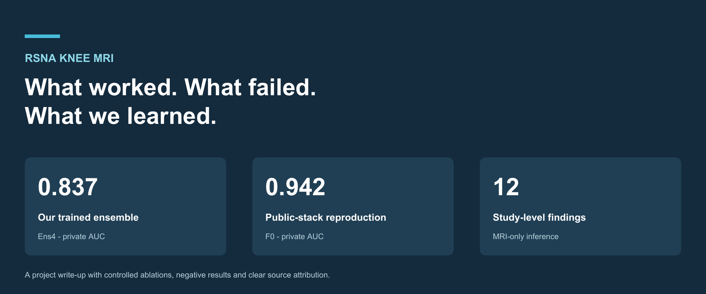
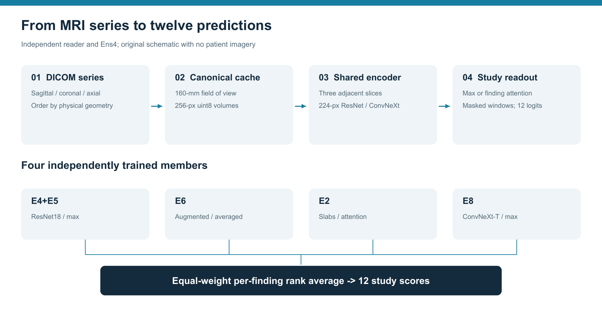
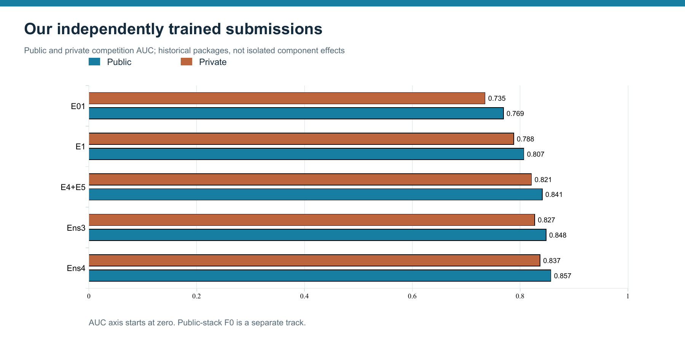
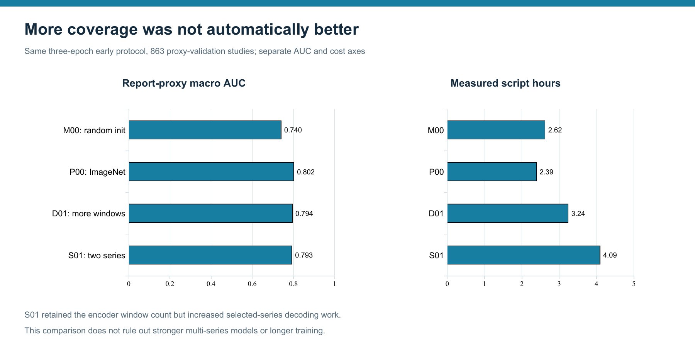
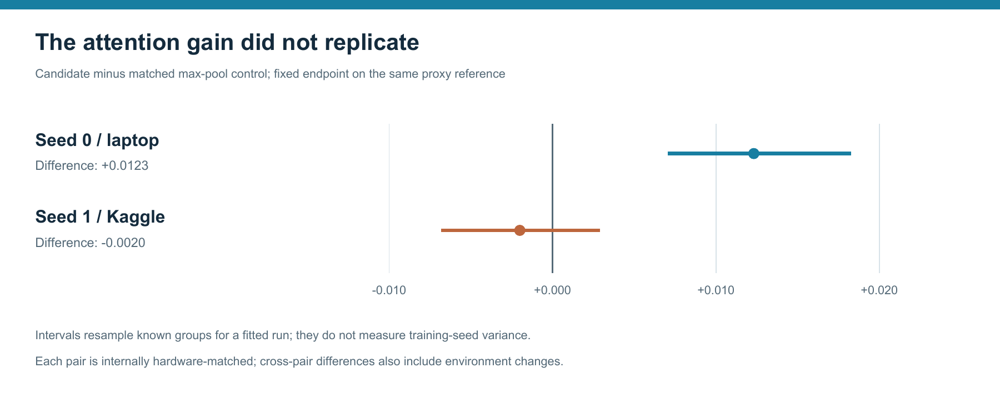
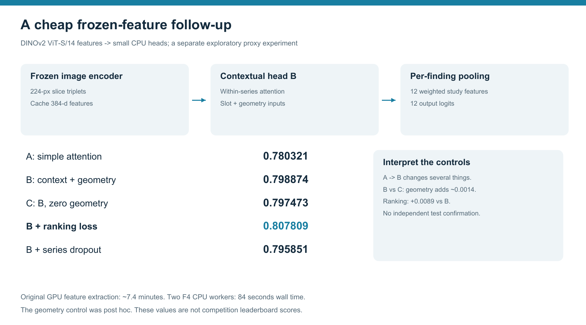

# Our RSNA Knee MRI Solution: What Worked, What Failed, and What We Learned

**2.5D readers, weak labels, a four-model ensemble, and a public-weights comparison**



Thanks to RSNA, Kaggle, the contributing institutions and the authors who shared
code, models and ideas. This is a retrospective write-up of our project. We did
not win a medal, but the experiments produced useful lessons about supervision,
model selection and working within a small compute budget.

There are two results to keep separate:

| Track | Public AUC | Private AUC | What it represents |
|---|---:|---:|---|
| Ens4, our trained models | **0.857** | **0.837** | Four readers trained from generic ImageNet initialization |
| F0, public-stack reproduction | **0.958** | **0.942** | An unchanged upstream ensemble using released competition checkpoints |

The higher score belongs to the reproduced public system. The architecture and
experiments we developed ourselves are described below. Later local candidates
were not all submitted standalone, so their validation results are not hidden-test
results. All leaderboard values use Kaggle's three-decimal display.

## 1. The problem: images at test time, reports during training

The task was to predict twelve knee MRI findings. There were 4,407 development
studies, 24,371 series and expert labels for only 58 studies. Most training
supervision therefore came from radiology reports. At inference, the model had
to work from the MRI alone.

That distinction mattered. A report can omit a finding or describe something
that does not satisfy the competition's positive threshold. A model that gets
better at reproducing report labels may not get equally better at reading images.
We used report-derived validation extensively, and we keep those scores separate
from organizer-evaluated leaderboard scores throughout this write-up.

## 2. Our image pipeline



*Figure 1. Our independently trained reader and Ens4. This is a schematic, with no patient images.*

The core idea was simple: treat one study as a bag of small image windows.

1. Sort DICOM slices using their physical geometry.
2. Canonicalize orientation and create a 160-mm central field of view.
3. Cache 256-pixel uint8 volumes using foreground percentile scaling.
4. Select sagittal, coronal and axial series, preferring fluid-sensitive and
   fat-suppressed inputs.
5. Stack three adjacent slices from one series into a three-channel 2.5D window.
6. Encode valid windows with one shared 2D CNN.
7. Pool the window features and produce twelve study-level outputs.

Most training recipes sampled four windows per plane; inference used sixteen
evenly spaced windows per plane. Inputs were resized to 224 pixels and used
ImageNet normalization. Missing windows were masked. Laterality-aware mirroring
was applied in the loading/inference path, rather than assuming an arbitrary
horizontal flip preserves medial and lateral anatomy.

Caching was a practical enabler: it avoided repeated DICOM decoding during
training. The same preprocessing function was included in the inference path.
Different cache generations remained paired with their own experiments.

### Two pooling heads

The max head used a feature-wise maximum across valid windows. The attention
head learned separate window weights for each finding, following attention MIL.
Both used shared image features and predicted the same twelve targets.

```text
attention[k, finding] = softmax(score(feature[k], finding))
pooled[finding]       = sum_k attention[k, finding] * feature[k]
logit[finding]        = classifier[finding](pooled[finding])
```

Finding-specific attention is an established method, not an algorithm we invented.
Our question was whether it helped under our data and training budget.

## 3. Our best independently trained submission: Ens4

Ens4 combined four readers with equal-weight per-finding rank averaging:

| Member | Backbone | Head | Main difference |
|---|---|---|---|
| E4+E5 | ResNet18 | Max | Report-v3 soft targets and clipped positive weighting |
| E6 | ResNet18 | Max | Augmentation, longer training and checkpoint averaging |
| E2 | ResNet18 | Finding attention | Fixed slab sampling |
| E8 | ConvNeXt-Tiny | Max | Different backbone and optimizer recipe |

Typical fitting used AdamW, cosine decay, fp16 AMP and batches of two studies.
Most members trained for twelve epochs; E6 used sixteen. The final ensemble
converted each member's predictions to percentile ranks and averaged them.
These are cohort-relative scores, not calibrated clinical probabilities.



*Figure 2. Historical submission progression. Each step is a recipe package, so the chart does not isolate a single cause.*

The independently trained line improved from **0.735 private** for E01 to
**0.837** for Ens4. Preprocessing, training duration, targets and model diversity
all changed during that progression. We cannot assign each leaderboard gain to
one component, even when its motivation was clear.

## 4. What our controlled tests actually showed

### Pretraining helped; extra coverage needed more than a larger input



*Figure 3. Matched early protocol: report-proxy AUC and measured script hours. These are not leaderboard scores. AUC bars start at zero.*

| Three-epoch experiment | Proxy macro AUC | Script hours |
|---|---:|---:|
| Random-init ResNet18 | 0.739719 | 2.62 |
| ImageNet ResNet18, P00 | 0.801735 | 2.39 |
| Twice the training windows, D01 | 0.793934 | 3.24 |
| Two series per plane sharing the window budget, S01 | 0.792733 | 4.09 |

ImageNet initialization clearly helped this short ResNet18 protocol. Doubling
training windows or spreading the same window count across two series did not
help the matched baseline. S01 also required more decoding time despite keeping
the encoder window budget fixed.

This does not mean more series are generally harmful. It means our particular
selection, pooling and three-epoch schedule did not make good use of them.

### Attention improved once, then failed to replicate



*Figure 4. Attention minus max pooling on the fixed proxy endpoint. Intervals are paired known-group bootstraps for one fitted run; they do not estimate seed variance.*

The first attention comparison gained **+0.0123** macro AUC. In the second
matched pair, its difference was **-0.0020**, with an interval crossing zero.
Each pair used the same hardware internally, but the first pair ran locally and
the second on Kaggle. The discrepancy therefore mixes seed and environment
changes. It still prevents a reliable claim that attention was better in our
setting based on the first result alone.

A later contextual package with slot/position embeddings and two Transformer
layers also underperformed its six-slot attention control. A more complicated
head did not automatically improve the reader.

## 5. A cheap follow-up: frozen DINOv2 features

We also tested a local frozen-feature pipeline. DINOv2 ViT-S/14 encoded
224-pixel windows once. Small heads then trained on CPU, using six plane/contrast
slots, validity masks and optional within-series context and geometry.



*Figure 5. Separate frozen-feature experiment on 863 proxy-validation studies. The geometry control was added post hoc, and all selected-epoch comparisons remain exploratory.*

| Head | Proxy macro AUC |
|---|---:|
| A: simple finding attention | 0.780321 |
| B: context, slot and geometry inputs | 0.798874 |
| C: same B capacity, geometry zeroed | 0.797473 |
| B plus pairwise ranking loss | 0.807809 |
| B plus series dropout | 0.795851 |

The large A-to-B difference changed capacity, context and metadata together.
The narrower B-versus-C diagnostic found only about **+0.0014** attributable to
the supplied geometry values. The ranking-loss arm gained about **+0.0089** over
B, while series dropout did not help this configuration.

The original feature extraction took about **7.4 minutes on a laptop GPU**.
The two follow-up F4 workers completed in **84 seconds on CPU**, using zero
Kaggle GPU hours. These were useful low-cost screening experiments, not evidence
that the heads beat Ens4 or F0 on the hidden test. The panels have different
recipes and references and should not be compared as one leaderboard.

## 6. The separate public-weights track

We reproduced the public stack from goodpjw2008 using nartaa's Raptor384 and
Raptor224, heliosli's R6 and the upstream small reader. That F0 reproduction
scored **0.958 public / 0.942 private**.

We then explored public-model fine-tuning, compartment tiles, teacher-denoised
labels, a student addition and inference-only blend variants.

| Entry | Change | Public | Private |
|---|---|---:|---:|
| F0 | Unchanged upstream stack | 0.958 | 0.942 |
| F1 | Add our S1-B student at fixed 20% rank weight | 0.954 | 0.938 |
| F3 | Shrink family weights toward equal | 0.957 | 0.942 |
| F5 | Remove small reader | 0.958 | 0.942 |
| F6 | Gaussian-rank blending | 0.958 | 0.942 |
| F7 | Squared percentile ranks | 0.958 | 0.942 |

None demonstrated a private gain over F0 at the displayed precision. Equal
rounded AUCs do not imply identical predictions. The student looked acceptable
under our development gates, yet its full-stack deployment regressed. Parent
correlation and a small-set gain were not enough to justify that addition.

## 7. What failed and what we would change

- **Fine-tuning into a near-copy.** Our low-rate, parent-anchored Raptor
  fine-tunes remained highly correlated with the parent. They did not establish
  useful incremental evidence for the full ensemble.
- **Numerical instability.** Some EfficientNet and aggressive warm-start runs
  overflowed or collapsed. A broken run is not a fair architecture comparison.
- **Approximate compartment crops.** Our fractional tiles did not provide the
  landmark-grounded, one-compartment-only view used by stronger specialist
  systems. Adding a zoom is not equivalent to anatomical supervision.
- **Weak validation transfer.** Report-derived references were useful for
  controlled development, but they did not independently establish diagnostic
  performance or the value of a public-stack blend.
- **Late fusion experiments.** Reweighting existing evidence was inexpensive,
  but it produced no demonstrated private gain in our final submissions.

For a future project we would prioritize a small, carefully evaluated
image-first labeling pilot; one stable multiview baseline; one genuinely
different anatomical specialist; and paired multi-seed confirmation before
expanding an ensemble. We would measure the change to the complete proposed
ensemble, rather than rely on a model's standalone score or decorrelation.

## 8. How this compares with the winning write-ups

The first-place author's currently published component uses image-reading
agents, ROI/lesion annotations, a detector and ROI pooling, with training-only
auxiliary targets. We did not build that spatial-supervision pipeline.

Third place combines image-derived targets, depth context, external OAI
supervision and a much larger group-budgeted ensemble. Several ingredients
overlap with ideas we explored, but their supervision and training programs were
much more developed. Their write-ups do not isolate one change that would
necessarily have closed our gap.

## 9. Reproducibility, limitations and acknowledgments

This is an empirical project write-up, not a new-architecture or clinical
validation claim. Our early and frozen-feature panels use 863 validation
studies; later N-series comparisons use 885. Bootstrap intervals condition on
the fitted run. Multiple seeds, a fixed confirmation protocol and an independent
reference remain necessary for stronger claims. The small expert set was used
historically in development, so it cannot be presented as untouched throughout.

Code references, source hashes, aggregate tables and the detailed methods are
available in our [technical report](../technical-report/REPORT.md). These figures
contain aggregate results and original schematics only. AI assistance was used
in implementation, analysis and writing; final scientific claims remain the
responsibility of the project's human authors.

Thanks to the competition organizers and to the authors of the public code,
weights and foundational methods we used:

- [Official competition](https://www.kaggle.com/competitions/rsna-knee-abnormality-detection)
- [Ilse et al.: attention-based MIL](https://proceedings.mlr.press/v80/ilse18a.html)
- [Medical Slice Transformer](https://arxiv.org/abs/2411.15802)
- [Upstream public stack reproduced as F0](https://www.kaggle.com/code/goodpjw2008/rsna-knee-coatnet-r6-2-5d-mil-lb-0-958)
- [First-place write-up](https://www.kaggle.com/competitions/rsna-knee-abnormality-detection/writeups/1st-place-solution)
- [Third-place write-up](https://www.kaggle.com/competitions/rsna-knee-abnormality-detection/writeups/3rd-place-solution-rsna-knee-abnormality-detectio)
