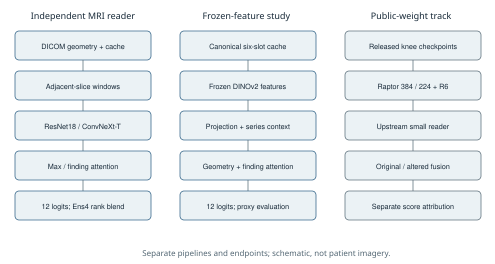
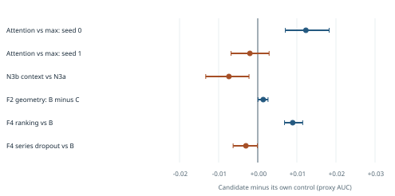

# Budgeted Model Selection for Weakly Supervised Knee MRI

**Technical report, version 1.0 | 25 October 2026**

Project: AYMENsl25/RSNA-competion-kaggle-project-. This retrospective report
documents the V2 study and its later competition experiments. It has not been
peer reviewed. Human author names and affiliations are not assigned by this
document. AI assistance was used in implementation, analysis and report preparation.

## Abstract

We examine model selection for twelve-finding knee MRI classification when most
supervision is derived from radiology reports and compute is limited. We developed
a shared-encoder 2.5D pipeline, investigated pretraining, pooling, series coverage,
context and label processing, and deployed a four-model ensemble. That independently
trained ensemble achieved 0.857 public and 0.837 private competition macro AUC.
A separate reproduction of an existing public checkpoint stack achieved 0.958
and 0.942, respectively. Under an early three-epoch protocol, ImageNet
initialization increased proxy AUC from 0.7397 to 0.8017, while denser training
windows and two-series sampling did not improve the matched control. In a later
comparison, attention pooling improved proxy AUC by 0.0123 in one seed, but its
advantage did not reproduce in a second matched pair. Frozen DINOv2 experiments
showed a combined context/capacity/metadata gain of 0.0186, while a matched-capacity,
post hoc control isolated a much smaller geometry increment of 0.0014. An
exploratory ranking-loss arm improved proxy AUC by 0.0089. These findings remain
conditional on weak references, limited seeds and reused validation data. We
describe provenance, resource costs, numerical failures and the distinction
between improved proxy agreement and improved hidden-test performance.

## 1. Task and study scope

The RSNA Knee Abnormality Detection competition required twelve study-level MRI
predictions: ACL, MCL, medial/lateral meniscus, medial/lateral/patellofemoral OA,
effusion, synovitis, Baker's cyst, contusion and fracture. The official development
cohort contained 4,407 studies and 24,371 series, with expert labels for 58 studies.
Most supervision therefore had to be constructed from reports or other permitted
sources. Evaluation used mean per-finding ROC-AUC. Test-time readers received
MRI without report text; submission inference ran offline [1].

Our study has two tracks. The independently trained track develops readers from
generic ImageNet or DINO initialization. The public-weights track reproduces and
adapts competition checkpoints released by other participants. Combining their
scores into a single architecture claim would obscure their different provenance.
The results below are reported by track and by evaluation reference.

This is a retrospective account of adaptive experimentation. Some comparisons
had fixed endpoints and promotion rules before execution; the entire study was
not prospectively registered. Plans, completed runs, exploratory diagnostics and
deployment measurements are distinguished throughout.

## 2. Data, supervision and evaluation cohorts

### 2.1 Report proxies and missing targets

Early experiments used a frozen public report-probability source. Observed
probabilities above or below 0.5 became positive or negative targets; exactly 0.5
was masked. Later experiments retained soft probabilities and used clipped
positive-class loss weights. Report mentions and report silence do not establish
the competition's image-positive criteria. AUC against these targets measures
proxy agreement rather than clinical diagnostic accuracy.

The early report-v3 label process applied training-developed severity rules to
effusion and Baker's cyst: qualifying mild-only mentions could be reduced to a
soft target of 0.3. It also retained soft values and masked unknown cells. These
changes were deployed together with loss changes in E4+E5; their individual
leaderboard contributions cannot be separated from that submission comparison.

A different, later teacher-v3 process blended report consensus with grouped
out-of-fold image-teacher predictions. The historical name "v3" appears in both
tracks; report-v3 and teacher-v3 are not interchangeable target files. This report
does not publish either label table.

### 2.2 Cohort versions

| Panel | Eligible training | Validation | Known validation groups | Reference |
|---|---:|---:|---:|---|
| Early M/P/D/S comparisons | 3,428 | 863 | 839 | Frozen report proxy |
| Later N-series comparisons | 3,428 | 885 | 843 | Frozen public/v3 proxy tables |
| F2/F4 frozen-feature study | 3,427 | 863 | 839 | Frozen public report proxy |
| Competition submissions | Model-specific training | Hidden test | Unavailable locally | Organizer image labels |

Known patient/report links and duplicate-audit exclusions informed grouping.
This does not prove complete patient or site independence. Early exclusions
included 65 expert-connected studies. Different all-masked-target rules explain
part of the validation-count difference between panels. Cohort membership,
reference versions and actual valid-target masks must accompany any recomputation.

F2 excluded one training study after selected-series cache QC failed; it used no
replacement series and had no validation QC exclusion. The expert cases were
excluded from its fitting. Later public-weight adaptation studies used small
expert-set diagnostics, and upstream competition checkpoints had their own
training and expert-selection histories. Consequently, the expert58 cannot be
described as untouched across the whole project.

## 3. Architecture and preprocessing



**Figure 1.** The independent reader and the frozen-feature experiment are
separate pipelines. All diagrams are original schematics; no patient images or
measured attention maps are shown.

### 3.1 Canonical cache and sampling in the Ens4 track

The V3 preprocessing function orders DICOM slices by physical position projected
onto the slice normal. It canonicalizes in-plane axes with flips/transposes,
forms a central 160-mm crop or pad, resizes to 256 pixels and scales intensities
using foreground percentiles before uint8 caching. Laterality is recorded in the
cache and applied by the loading/inference path. Mirroring reverses sagittal
slice order or flips coronal/axial columns, preserving the intended medial/lateral
meaning. The same canonicalization implementation is shared with inference.

For the three-slot readers, one series per sagittal/coronal/axial role is selected
using the fluid-sensitive, fat-suppression and UID preference. A window contains
three adjacent source slices from a single series. Most training recipes sample
four random windows per role; inference uses sixteen evenly spaced windows per
role. Inputs are resized to 224 pixels and normalized with ImageNet statistics.
The E2 variant uses fixed slab sampling. Missing windows are masked and do not
enter the encoder or pooling operation.

These statements describe the Ens4 preprocessing generation. The early baseline
and later native-resolution caches have their own frozen source versions; they
must not be silently replaced with this cache in a purported reproduction.

### 3.2 Shared encoder and aggregation

ResNet18 or ConvNeXt-Tiny maps each valid 2.5D window to a feature vector. The max
head takes the feature-wise maximum over windows and applies a twelve-output
linear layer. The attention head learns a separate weighting over windows for
each finding, with gated attention and a plane bias, following established
attention-MIL principles [2].

For a study with window features h and finding c, the general attention form is:

```text
alpha[k,c] = softmax_over_valid_windows(attention_c(h[k]))
pooled[c]  = sum_k alpha[k,c] * h[k]
logit[c]   = dot(classifier[c], pooled[c]) + bias[c]
```

The six-slot bridge distinguishes plane and fluid/non-fluid contrast. The N3b
context package adds a 384-dimensional projection, learned slot and normalized
slice-position embeddings, and two Transformer layers before finding-specific
pooling. This package changes several components together; its outcome cannot
be assigned solely to self-attention.

### 3.3 Independently trained deployed ensemble: Ens4

| Member | Backbone | Aggregation | Main recipe differences |
|---|---|---|---|
| E4+E5 | ImageNet ResNet18 | Max | Report-v3 soft targets and clipped positive weighting |
| E6 | ImageNet ResNet18 | Max | Anatomical augmentation, 16 epochs, checkpoint averaging |
| E2 | ImageNet ResNet18 | Finding attention | Fixed slab sampling |
| E8 | ImageNet ConvNeXt-Tiny | Max | Different backbone and optimizer recipe |

Ens4 averages per-finding percentile ranks of these four members with equal
weights. Rank conversion is performed over the evaluation population, making
the final values cohort-relative scores rather than calibrated probabilities.
Individual members predict MRI findings without report input at inference.

Typical fitting used batch size two, AdamW, cosine decay and fp16 AMP. ResNet
recipes used learning rate 3e-4 and weight decay 0.01; the ConvNeXt-Tiny recipe
used 1e-4 and 0.05. Training lasted 12 epochs for most members and 16 for E6.
The reported deployment bundle retains its selected/averaged checkpoints and
does not represent four otherwise identical models.

### 3.4 Frozen DINOv2 experiment

F2 encodes 224-pixel adjacent-slice windows using a frozen generic DINOv2
ViT-S/14 encoder. Up to eight deterministic centers are retained in each of six
plane/contrast slots. The 384-dimensional CLS feature is projected to 128
dimensions for CPU head training. DINO plus sequence aggregation already has
medical-volume precedent, including knee MRI [3].

Head A uses finding-specific pooling. Head B adds slot embeddings, five
physical/relative geometry values and a within-series Transformer. Geometry
includes centered physical position, neighboring gaps, series extent and
relative position. Cross-series registration is not assumed. Head C retains B's
capacity and initialization construction but receives zero geometry; this
diagnostic was added after the initial A/B result.

F4 adds two separate CPU experiments to B: BCE plus a 0.25-weighted pairwise
logistic ranking term, and whole-series training dropout with probability 0.2.
The dropout arm retains at least one available series. These use the same
features, training order and twelve-epoch schedule, with independent seeded
dropout draws. Ranking is an elementary surrogate, not a reproduction of a
specialized deep-AUC optimizer.

## 4. Statistical and engineering protocol

The primary development measure is twelve-target macro ROC-AUC on the specified
proxy table. Saved comparisons use paired resampling of known groups, commonly
1,000 draws; F4 uses 500. The same resampled groups are used for both models in
a comparison. These intervals measure evaluation-sample variation conditional
on a fitted run and reference. They do not capture training-seed variance,
systematic label error, multiple comparisons or adaptive selection.

Some comparisons fix the final epoch; F2/F4 select highest observed validation
AUC, then lower BCE, then earlier epoch. These selected-checkpoint intervals are
exploratory because the same fold is used for selection. Equal epochs also do
not imply equal optimizer updates, examples or compute. An altered cosine
horizon changes the optimization trajectory.

Source/configuration hashes, split and label hashes, saved predictions, output
schemas, masks, failures and resource measurements are retained. Selected F2
checkpoints have historical strict-reload receipts reproducing all 863 by 12
validation probabilities exactly. Report preparation checked the receipt and
source hashes; it did not repeat training or recompute all per-study metrics.

The report package contains aggregate tables only. The publication evidence
manifest records source-document and aggregate-artifact hashes without exposing
study identifiers, reports, labels, predictions or model weights.

## 5. Results

### 5.1 Initialization and coverage at three epochs

| Variant | Proxy macro AUC | Script hours | Peak reserved MiB |
|---|---:|---:|---:|
| M00 random-init ResNet18, max | 0.739719 | 2.62 | 760 |
| P00 ImageNet ResNet18, max | 0.801735 | 2.39 | 760 |
| D01 doubled training windows | 0.793934 | 3.24 | 982 |
| S01 two series/plane, fixed windows | 0.792733 | 4.09 | 760 |

P00 minus M00 was +0.062016, with a paired group interval [0.049379, 0.075216].
D01 and S01 were below the matched P00: -0.007801 [-0.014713, -0.001354] and
-0.009002 [-0.017304, -0.001241], respectively. This supports ImageNet
initialization in this protocol, but not a general claim that additional series
are harmful. S01 increases decoding work despite a fixed encoder window budget.
The separate six-epoch E01 reached 0.821538 and required 5.10 script hours;
duration and schedule differ from the three-epoch controls.

### 5.2 Attention replication and the context package



**Figure 2.** Within-panel paired differences against the stated control.
Intervals condition on one fitted run. The context and geometry comparisons
have different controls and cannot be interpreted as a common leaderboard.

| Comparison | Control AUC | Candidate AUC | Difference [95% group interval] |
|---|---:|---:|---|
| Attention vs max, seed 0 | 0.874449 | 0.886765 | +0.012316 [0.007050, 0.018267] |
| Attention vs max, seed 1 | 0.884574 | 0.882570 | -0.002004 [-0.006823, 0.002906] |
| N3b context vs N3a attention | 0.888463 | 0.881085 | -0.007377 [-0.013300, -0.002236] |

The initial attention gain did not reproduce. Each pair is hardware-matched
internally, but the first ran on a laptop and the second on Kaggle; cross-pair
variation therefore mixes seed and environment changes. This is evidence
against a robust superiority claim from the existing results, not proof that
max pooling is universally better. The N3b result concerns a particular context
package and training recipe.

### 5.3 Frozen-feature controls

| Head | Proxy macro AUC | Interpretation |
|---|---:|---|
| A: simple attention | 0.780321 | Frozen-feature control |
| B: context, slot, geometry | 0.798874 | Combined capacity/context/metadata change |
| C: B capacity, zero geometry | 0.797473 | Post hoc geometry diagnostic |
| B plus ranking loss | 0.807809 | Single-seed exploratory gain |
| B plus series dropout | 0.795851 | No gain in this configuration |

B minus A was +0.018553 [0.012153, 0.025107]. This does not isolate geometry.
B minus C was only +0.001401 [0.000079, 0.002633]. The ranking arm improved B
by +0.008935 [0.006851, 0.011496]; dropout reduced it by -0.003022
[-0.006301, -0.000093]. These results reuse the development fold and require
paired-seed and independent-reference confirmation.

Feature extraction on a laptop RTX 4050 took 443.25 seconds for 4,290 studies
and 166,008 windows. The paired A/B run, including setup/extraction/analysis,
took 512.39 seconds. The C diagnostic took 50.78 CPU seconds, and the concurrent
F4 workers took 84.45 wall seconds. Zero Kaggle GPU hours were used for F2/F4;
local GPU extraction was used. These measurements are not a matched-quality
efficiency comparison with the stronger end-to-end readers.

### 5.4 Independently trained competition submissions

| Entry | Main changes | Public AUC | Private AUC |
|---|---|---:|---:|
| E01 | Six-epoch ResNet18 baseline | 0.769 | 0.735 |
| E1 | Cache/normalization/mirroring and longer training | 0.807 | 0.788 |
| E4+E5 | Report-v3, soft targets and loss changes | 0.841 | 0.821 |
| Ens3 | Add E6 and E2 through rank averaging | 0.848 | 0.827 |
| Ens4 | Add ConvNeXt-Tiny E8 | 0.857 | 0.837 |

These are historical recipe packages, not an isolated causal decomposition of
preprocessing, supervision and architecture. The final private-minus-public
difference for Ens4 is -0.020. Local report-proxy validation for Ens4 was about
0.880; that value has a different reference and cohort from either leaderboard.
Not every later development model was submitted standalone.

### 5.5 Public-weight reproduction and adaptation

F0 reproduces goodpjw2008's stack using nartaa's Raptor384/Raptor224, heliosli
R6 and the small reader [4]. K1 fine-tunes were highly similar to the Raptor
parent, with reported prediction-rank correlations around 0.986-0.988. K3/K4
tested approximate compartment tiles; T1/S1 explored teacher-derived targets.
Several arms suffered fp16 overflow or collapsed after large encoder updates.
These failures were not repaired into a fair comparison for every backbone.

| Entry | Change | Public AUC | Private AUC |
|---|---|---:|---:|
| F0 | Unchanged upstream stack | 0.958 | 0.942 |
| F1 | F0 plus fixed 20% S1-B student rank blend | 0.954 | 0.938 |
| F3 | Shrink main family weights toward equal | 0.957 | 0.942 |
| F5 | Remove small reader | 0.958 | 0.942 |
| F6 | Gaussian-rank main aggregation | 0.958 | 0.942 |
| F7 | Squared percentile ranks | 0.958 | 0.942 |

All leaderboard values use Kaggle's three-decimal display. Equal displayed
scores do not establish equal predictions or unrounded AUC. There was no
demonstrated private improvement over F0. S1-B's development gates compared it
with a parent on a small expert set, not an honest held-out full-F0 ensemble;
its deployed blend regressed. This illustrates an inadequate promotion test
without proving a single explanation for the regression.

## 6. Relation to published competition solutions

The first-place write-up currently presents one teammate's component. It uses
agent-produced soft labels, anatomical ROI and lesion boxes, a learned detector,
ROI-restricted pooling, and lesion/report-embedding auxiliary tasks. These add
supervision and spatial evidence we did not build. The author's single-model
efficiency entry reports private AUC 0.954; this is not the complete winning
team's ensemble score [5].

Third place reports 0.959 private with 36 checkpoints, image-derived soft
targets, depth context, backbone/resolution diversity and group-budgeted
probability fusion. OAI training is used in 23 members. Non-refit and expert-case
refit variants both display 0.959 private, so their table does not establish a
refit gain at that precision. Several interventions are bundled [6].

These primary author accounts suggest promising directions but do not prove
which intervention would close our gap. Attention MIL [2] and DINO-plus-Transformer
volume processing [3] predate this work. Our report's contribution is empirical
comparison and transparent failure/provenance accounting rather than a claim
to have invented these components.

## 7. Lessons, limitations and next experiments

First, better agreement with report-derived labels is an incomplete development
objective. We did not implement full-dataset image-first supervision, lesion
annotations or a landmark-based single-compartment classifier. It is plausible
that supervision and spatial evidence constrained us, but our experiments do
not identify a hard label-quality ceiling or causally explain the full gap.

Second, a significant-looking interval for one trained run does not establish
repeatability. The attention replication is a direct warning against selecting
an architecture on one seed. Context/capacity controls are also necessary:
the F2 A/B difference was much larger than the isolated geometry diagnostic.

Third, a diverse model is not automatically a useful ensemble member.
Prediction correlation is not error correlation. Development gates should
measure the paired change of the complete proposed ensemble under an honest
reference. Public-parent training on available development studies complicates
such a reference; making a new random split does not erase that history.

Fourth, compute and deployment engineering influence which comparisons are
actually feasible. Cache parity, native spatial detail, series boundaries,
laterality, masks, source snapshots, fail-fast numerical checks and decoding
costs are part of a reproducible experimental method. A three-visible-study
preview establishes execution, not full hidden-runtime feasibility.

The study is limited by weak targets, adaptive experimentation, limited paired
seeds, changing cohorts, unresolved patient/site-independence checks and
historical use of the small expert set. F2's large cache-array hashes were
retained from recorded provenance rather than recomputed during this audit.
E01 saved all six epochs but has a documented late summary-status inconsistency.
Numerical failures and incomplete follow-ups are not successful comparisons.

The highest-value confirmation would freeze one question, repeat the cheap
geometry/ranking heads across paired seeds, and repeat the attention pair in
one environment. Stronger diagnostic claims require an independent reference
and a frozen design; the consumed expert set and private leaderboard cannot
serve as newly untouched tests. This report launches no confirmation training.

## 8. Reproducibility and availability

The report is accompanied by machine-readable aggregate results, an evidence
manifest, vector figures and a deterministic report builder. The builder reads
only those aggregate files and report text. It does not access MRI, labels,
per-study predictions, credentials, model checkpoints or network services.
The package is therefore reproducible as a report; full training reproduction
requires separately obtained data and exact recorded environments/artifacts.

Relevant repository source includes canon.py, m00_model.py, v3_model.py,
train_v3.py, f2_data.py and f2_model.py. The report makes no new ownership or
license claim over upstream code, weights or competition data. Release/access
terms remain those of their respective sources. No patient images, identifiers,
report text, label rows or model binaries accompany this report.

## 9. Conclusion

Our strongest independently trained scored entry achieved 0.837 private AUC,
while a reproduced public stack achieved 0.942. Within explicit weak-label
protocols, pretraining helped, broader fixed-budget sampling did not, and an
initial attention advantage failed to replicate. Frozen-feature experiments
identified cheap hypotheses for confirmation but did not establish clinical or
hidden-test gains. The reusable outcome is a documented model-selection
process with controlled comparisons, negative results and clear provenance.

## References

[1] [RSNA Knee Abnormality Detection competition](https://www.kaggle.com/competitions/rsna-knee-abnormality-detection). Official task, cohort and evaluation.

[2] Ilse, Tomczak and Welling. [Attention-based Deep Multiple Instance Learning](https://proceedings.mlr.press/v80/ilse18a.html). ICML, 2018.

[3] Mueller-Franzes and colleagues. [Medical Slice Transformer](https://arxiv.org/abs/2411.15802). Preprint 2024; Scientific Reports publication linked from the paper record.

[4] goodpjw2008. [Public CoAtNet/R6/2.5D MIL stack](https://www.kaggle.com/code/goodpjw2008/rsna-knee-coatnet-r6-2-5d-mil-lb-0-958). F0 reproduced version 27, with weights and code attributed to nartaa, heliosli and the upstream reader authors.

[5] Team Kangaroo, teammate's component. [First-place solution](https://www.kaggle.com/competitions/rsna-knee-abnormality-detection/writeups/1st-place-solution). Author write-up, accessed 25 October 2026.

[6] DataTech team. [Third-place solution](https://www.kaggle.com/competitions/rsna-knee-abnormality-detection/writeups/3rd-place-solution-rsna-knee-abnormality-detectio). Author write-up, accessed 25 October 2026.

## Appendix A. Internal evidence map

Machine-readable source hashes are listed in data/evidence_manifest.json. Paths
below are relative to V2_new_research unless otherwise stated.

| Report result | Source record |
|---|---|
| M00/P00 pretraining | research/P00_P01A_FULL_RESULTS_AND_NEXT.md |
| D01/S01 | research/D01_S01_RESULTS_AND_TWO_PLANS.md |
| Attention seed 0 | research/N1_RESULTS_AND_N3A_DECISION.md |
| Attention seed 1 | research/N6_RESULTS.md |
| N3b context package | outputs/n3b_context/vs_n3a_public.json |
| F2 controls | research/F2_LOCAL_DINO_RESULTS_2026-10-20.md |
| F4 ranking/dropout | research/F4_CPU_TRIALS_2026-10-21.md |
| K/T/S adaptations | research/K1_F0_PUBLIC_WEIGHTS_TRACK.md |
| Ens4 implementation | Repository docs/OUR_BEST_MODEL.md; original source code |
| Final scores | Kaggle account history, checked 25 October 2026 |

Some aggregate sources are intentionally local and are represented by hashes
rather than redistributed artifacts. Their absence from the repository is
explicit; this report does not claim a fresh clean-environment reproduction.
